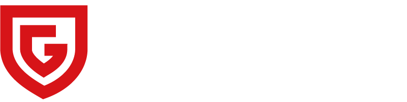

# 品牌资产规范

## 强制规则

- MUST 使用本文列出的正式资产文件，不得重新绘制或由 AI 生成近似 Logo。
- MUST 保持 Logo 原始宽高比，不得拉伸、压缩、裁切或旋转。
- MUST 在浅色背景使用标准色版本，在深色背景使用反白版本。
- MUST NOT 擅自改色、加描边、阴影、渐变、发光或背景容器。
- MUST NOT 将公司名称重新排版后冒充正式组合标识。
- SHOULD 优先使用 SVG；PNG 仅作为反白位图或不支持 SVG 时的兼容版本。

## 已整理资产

| 变体 | 文件 | 技术信息 | 使用场景 |
|---|---|---|---|
| 中英文横版标准色 | `src/assets/brand/logos/zkgy-logo-horizontal-color.svg` | 矢量路径；`viewBox="0 0 266.5 66.87"`；无字体和外链图片依赖 | 浅色或白色背景；网站导航和常规品牌露出；网页首选版本 |
| 中英文横版反白 | `src/assets/brand/logos/zkgy-logo-horizontal-reverse.png` | `801 × 202`；RGBA；透明背景 | 深色背景；现阶段反白兼容版本 |

## 选择逻辑

1. 背景为白色或浅色：使用 `zkgy-logo-horizontal-color.svg`。
2. 背景为深色：使用 `zkgy-logo-horizontal-reverse.png`。
3. 需要大尺寸反白 Logo：不要放大 PNG，也不要自行把标准色 SVG 改成白色；应补充官方反白 SVG。
4. 没有明确背景对比度时：停止选择并先确认页面背景。

## 实现方式

在 React/Vite 项目中从资产目录导入，不要复制 SVG 源码到页面组件：

```tsx
import logoHorizontalColor from '@/assets/brand/logos/zkgy-logo-horizontal-color.svg';


```

深色表面使用反白版本：

```tsx
import logoHorizontalReverse from '@/assets/brand/logos/zkgy-logo-horizontal-reverse.png';


```

实际 CSS 尺寸可响应式缩放，但必须使用 `height: auto` 保持比例。

## 无障碍

- Logo 链接到首页时，使用 `alt="中科固源首页"`。
- Logo 纯装饰且附近已有等价品牌文字时，使用空替代文本 `alt=""`。
- 不要在相邻可见文字和 `alt` 中重复冗长的公司介绍。

## Lovable 执行要求

在创建或修改导航、页脚、登录页、品牌页以及其他含 Logo 的界面前：

1. 先读取本文件。
2. 根据背景选择已批准的变体。
3. 引用现有资产，不得生成、重绘或用文字替代 Logo。
4. 不得直接使用原始中文文件名或本地 Desktop 绝对路径。
5. 如果现有两种变体不适用，报告缺失的资产变体，不得自行制作。

## 网联汽车方案组成插图

用户指定生成的语义插图，仅用于 `/solution-auto.html` 方案组成，不作为真实设备或界面证据，不用于 Logo。

| 文件 | 对应语义 |
|---|---|
| `src/assets/auto-solution-firmware.jpg` | OTA 与固件安全 |
| `src/assets/auto-solution-protocol.jpg` | 通信与协议安全 |
| `src/assets/auto-solution-chip.jpg` | 硬件与芯片安全 |
| `src/assets/auto-solution-vehicle.jpg` | 整车台架攻防区 |
| `src/assets/auto-solution-compliance.jpg` | 数据与合规管理 |

冰蓝、银白、浅灰、淡紫，柔光、低对比阴影与留白，不改变页面颜色 Token。原生生成图片直接导入；媒体合约见 `../components/solution-showcase-media.md`。

## 预览

### Swift AI 首屏概念配图

- 文件：`src/assets/swift-ai-hero-core-light.jpg`，仅用于 `/ai.html` 首屏右侧。
- 用户上传的官方概念插图浅色版（1672 × 941 原图，等比裁切为 1291 × 941 以匹配首屏图片框比例）：白色金属底座上的全息玻璃分层架构，顶层发光立方体内含神经网络与防护盾徽记，中层为芯片、网络模块、服务器机柜与数据库单元；双轨道环绕，承载数据分析、智能体、对话交互、模型资产四个发光玻璃徽记。高光调白灰环境、电光青蓝与淡紫。
- 同一构图另有深色底版本 `src/assets/swift-ai-hero-core.jpg`（同样由用户上传，1291 × 941），当前未被引用。
- 语义：传统模型对抗测评、LLM 安全测评与防火墙、自动化红队、AI BOM；不作为真实产品界面证据。
- 直接导入项目资产，沿用原有首屏图片框与圆角，不改变页面配色 Token。

### Swift AI「为什么选择」能力卡片插图

用户指定生成的语义插图，仅用于 `/ai.html`「为什么选择Swift AI？」卡片配图，不作为真实产品界面证据，不用于 Logo。

| 文件 | 对应语义 |
|---|---|
| `src/assets/ai-feature-lifecycle.jpg` | 全生命周期模型安全检测 |
| `src/assets/ai-feature-multimodal.jpg` | 多模态统一风险检测引擎 |
| `src/assets/ai-feature-compliance.jpg` | 对齐监管标准的合规评估体系 |

### Swift SCA 首屏概念配图

- 文件：`src/assets/sca-hero-dashboard.png`，仅用于 `/sca.html` 首屏右侧，替换原占位视频与此前的玻璃防护盾概念图。
- 1404 × 1024（匹配首屏图片框 600 / 437.5 比例）；原始上传件为透明底卡片组合，已合成到浅灰画布 `#f4f5f7` 以保留卡片投影层次，左右各裁 66 px 凑齐比例，四张卡片与全部文字未被切掉。
- 内容为产品总览：项目总数 48、扫描次数 1.5K、发现数量总计 5K、统计总数 8、按严重程度的发现数量、合规标准状态分布，以及依赖项／代码／高风险许可证发现数量；数值为用户提供的示意数据，不作为真实客户数据证据。
- 直接导入项目资产，沿用原有首屏图片框与圆角，不改变页面颜色 Token。

1024 × 768，高光调白灰环境、透明玻璃与亚克力折射、电光青蓝与淡紫柔光、低对比阴影与大面积留白；不改变页面颜色 Token。原生生成图片直接导入，媒体合约见 `../components/feature-cards.md`。

标准色版本：


反白版本具有透明背景，应在深色表面中检查：



## Swift SCA「OSS 统一开源政策」卡片插图

- `src/assets/sca-oss-deps.jpg`（1024×768）：玻璃碎片球体 + 冰蓝扫描光环，对应「100% 全量依赖评估」。
- `src/assets/sca-oss-share.jpg`（1024×768）：玻璃量筒装满发光代码块，对应「90%+ 开源代码占比」。
- `src/assets/sca-oss-filter.jpg`（1024×768）：玻璃漏斗筛分立方体流，对应「50% 风险自动筛除」。
- `src/assets/sca-oss-audit.jpg`（1024×768）：玻璃秒表 + 报告堆叠，对应「70% 审计效率提升」。
- 风格与 solution-auto「业务场景」一致：银白亮底、磨砂玻璃、冰蓝光线、淡紫高光、大量留白。

## Swift SCA「产品功能」SBOM 面板截图

- 文件：`src/assets/sca-sbom-components.png`（1084 × 669，仅用于 `/sca.html`「产品功能」第一个 Tab「SBOM与资产管理」的右侧配图框）。
- 用户上传的真实产品界面截图（SBOM 探索页组件列表）裁切而成：原图 1672 × 941，裁切窗口 (38, 179, 1122, 848)，宽高比 1.6203 与配图框 1.62 一致，`object-fit: cover` 不再额外切掉内容。
- 裁切边界对齐界面元素：左为侧栏卡片外缘，上为筛选栏，右为 CPE 与 PURL 列分隔线，下为第十行数据行分隔线；截图自带的浅灰画布留白已全部去除，四边不露底。
- 侧栏「组件 1,028 / 许可证 86」、页签、筛选控件、卡片标题、工具栏与 10 行组件数据完整可读；PURL、许可证与操作列、分页条在画面外，读作页面延续。
- 通过 `HomeAccordionItem.image` 接入，配图框尺寸、圆角、主题边框、自动切换与暂停行为均不变；alt 为中文描述。

## Swift SCA「产品功能」漏洞管理面板截图

- 文件：`src/assets/sca-vuln-management.png`（1405 × 867，仅用于 `/sca.html`「产品功能」第二个 Tab「保障与漏洞管理」的右侧配图框）。
- 用户上传的真实产品界面截图（漏洞管理页）裁切而成：原图 1672 × 941，裁切窗口 (45, 53, 1450, 920)，宽高比 1.6205 与配图框 1.62 一致，`object-fit: cover` 不再额外切掉内容。
- 裁切边界对齐界面元素：上为「漏洞管理」标题上方留白（避开页首面包屑），左为漏洞列表卡片外缘，下为卡片底部边框线（含分页条「共 78 条数据」），右为「漏洞」列数值（5161 / 0）之后、「操作」列分隔线之前的空白区；截图自带的浅灰画布留白已全部去除，四边不露底。
- 标题「漏洞管理」、副标题、筛选卡、页签（「漏洞管理」高亮）与 10 行漏洞数据完整可读；「操作」列与面包屑在画面外，读作页面延续。
- 通过 `HomeAccordionItem.image` 接入，配图框尺寸、圆角、主题边框、自动切换与暂停行为均不变；alt 为中文描述。

## Wisdom Lens「产品功能」修复建议面板截图

- 文件：`src/assets/lens-fix-suggestions.png`（1245 × 769，仅用于 `/lens.html`「产品功能」第四个 Tab「提供修复建议」的右侧配图框）。
- 用户上传的真实产品界面截图（缺陷分析详情页）处理而成：原图 1286 × 688，先裁掉截图自带的近黑死边（左 26px、右 15px、底 10px），再按配图框 1.62 比例在上下各补一段与相邻行同色的背景，使宽高比 1.619 与配图框一致，`object-fit: cover` 不再额外切掉内容。
- 与「产品截图裁切铺满规则」的差异：本截图内容本身已顶满画布，无法再靠裁切凑比例，因此改为补边；补边取相邻行同色延展，四边无接缝、无白边。
- 面包屑「源代码模糊 / 测试记录 / 测试记录详情 / 缺陷分析」、标题「CWE-121_基于堆栈的缓冲区溢出」、「严重」徽记、所属项目与发现时间、页签「详细信息」，以及卡片「示例与修复建议」下的漏洞影响描述、伪代码、修复建议五条完整可读。
- 通过 `HomeAccordionItem.image` 接入，配图框尺寸、圆角、主题边框、自动切换与暂停行为均不变；alt 为中文描述。

## Wisdom Lens「产品功能」测试驱动生成面板截图

- 文件：`src/assets/lens-test-driver.png`（809 × 500，仅用于 `/lens.html`「产品功能」第二个 Tab「测试驱动生成」的右侧配图框）。
- 用户上传的真实产品界面截图（添加项目弹窗）裁切而成：原图 809 × 748，取顶部 0–500 行，宽高比 1.618 与配图框 1.62 一致，`object-fit: cover` 仅切掉不到 1px，四边不露底。
- 裁切边界对齐弹窗元素：上边即弹窗圆角顶边（截图本身从顶边起，无画布留白），下边落在「配置测试驱动」单选项与「描述」标题之间的空白区，读作表单延续。
- 弹窗标题「添加项目」与关闭按钮、`* 上传方式`（本地导入）、`* 上传文件`（点击或拖拽上传 + 最大2GB 提示）、`编译环境`（上传 + 提示）、`* 配置测试驱动`（自动生成驱动 / 自定义上传驱动）完整可读；`描述` 输入框与「取消 / 确定」按钮在画面外。
- 左右两侧保留弹窗下方「项目管理」列表与「创建时间」列的局部文字，读作真实页面背景，未额外补边。
- 通过 `HomeAccordionItem.image` 接入，配图框尺寸、圆角、主题边框、自动切换与暂停行为均不变；alt 为中文描述。

## Wisdom Lens「产品功能」缺陷挖掘与定位面板截图

- 文件：`src/assets/lens-vuln-locate.png`（1272 × 785，仅用于 `/lens.html`「产品功能」第三个 Tab「缺陷挖掘与定位」的右侧配图框）。
- 用户上传的真实产品界面截图（缺陷分析详情页）处理而成：原图 1272 × 756（宽高比 1.6825），内容已顶满画布四边、左右仅 13px 页面底色沟槽且顶部面包屑文字从 x=11 起，无法靠裁切凑出配图框比例；按「产品截图裁切铺满规则」的补边分支，在底部延展 29 行末行像素（卡片同色面、两侧沟槽对齐），使宽高比 1.6204 与配图框一致，`object-fit: cover` 不再额外切掉内容。
- 面包屑「源代码模糊 / 测试记录 / 测试记录详情 / 缺陷分析」、标题「CWE-400_资源消耗/拒绝服务」、「高危」徽记、所属项目 xy-网络服务与发现时间、页签「详细信息」，以及卡片「异常用例」（ID、崩溃信号 hang、触发位置、来源 src:000981、已执行次数 222762、重复变异次数 3）与「源码锚点」（代码位置 dnsmasq-2.89/src/option.c:5726、源文件、异常行数、所属函数 read_opts）完整可读。
- 补边区为卡片同色空白，四边无接缝、无白边；卡片在画面下方与右侧延续，读作页面继续。
- 通过 `HomeAccordionItem.image` 接入，配图框尺寸、圆角、主题边框、自动切换与暂停行为均不变；alt 为中文描述。

## Wisdom Lens「产品功能」覆盖率反馈和优化面板截图

- 文件：`src/assets/lens-coverage-feedback.png`（1274 × 786，仅用于 `/lens.html`「产品功能」第一个 Tab「覆盖率反馈和优化」的右侧配图框）。
- 用户上传的真实产品界面截图（测试记录详情 · 数据统计图）处理而成：原图 1274 × 760（宽高比 1.6763），深色界面已顶满画布四边、左右仅 20px / 9px 页面底色沟槽，无法靠裁切凑出配图框比例；按「产品截图裁切铺满规则」的补边分支，在底部延展 26 行（取末 10 行逐列均值，卡片同色面、两侧沟槽对齐），使宽高比 1.6209 与配图框一致，`object-fit: cover` 不再额外切掉内容。
- 面包屑「源代码模糊 / 测试记录 / 测试记录详情」、标题「xy-网络服务」与「源代码模糊」徽记、任务名称与起止时间与总运行时长与编译器工具链元信息、页签「测试信息 / 数据统计图」，以及「覆盖率」曲线（0%–50% 纵轴、五个时间刻度）、「执行速率趋势」曲线（0–50,000 纵轴）与「新路径发现趋势」卡片标题完整可读。
- 补边区为卡片同色空白，四边无接缝、无白边；「新路径发现趋势」卡片在画面下方延续，读作页面继续。
- 通过 `HomeAccordionItem.image` 接入，配图框尺寸、圆角、主题边框、自动切换与暂停行为均不变；alt 为中文描述。

## Wisdom Lens 首屏概念配图

- 文件：`src/assets/lens-hero-fuzz-pipeline.png`（561 × 409，仅用于 `/lens.html` 首屏右侧配图框）。
- 用户再次上传的同构图深色玻璃拟态概念插图（561 × 392，宽高比 1.4311）处理而成：画面已顶满画布、四周仅 10–15px 暗背景沟槽，无法靠裁切凑出配图框比例；按「产品截图裁切铺满规则」的补边分支，在上下各延展 8 / 9 行逐列均值暗色，使宽高比 1.3716 与首屏配图框 600 / 437.5 一致，`object-fit: cover` 不再切掉任何元素。
- 清晰度备注：该导出仅 561 × 392，在 600 × 438 配图框（视网膜屏 1200 × 876）中放大约 2 倍，细节偏软；同名构图的 1673 × 940 高清导出曾在本会话出现，如用户需要清晰版可按同一补边方式重做。
- 画面内容全部保留：中央分层代码屏幕与红色漏洞靶标（四角瞄准框）、左侧代码 / 构建 / 配置 / 版本四类输入模块、右侧告警 / 统计 / 防护三类结果卡片、底部 Dev > Build > Test > Security > Deploy 流程条（Test 高亮）。
- 延展区为原图同色暗背景，上下无接缝、无白边；首屏底色 `#151515` 与插图暗背景过渡自然。
- 通过 `ProductHero` 的 `visual` 接入，配图框尺寸（600 × 437.5）、圆角与高优先级加载与 `sca.html` 首屏一致；alt 为中文描述。

## Swift Code 首屏配图

- 现用：`src/assets/swiftcode-hero-dashboard.jpg`（1336 × 974，宽高比 1.3717 与首屏配图框 600 / 437.5 一致），仅用于 `/swiftcode.html` 首屏右侧配图框。
- 用户上传的真实产品仪表盘截图处理而成：原图 1536 × 1024（透明背景），先按截图自带的浅灰画布底色（约 #F0F1F6）合成铺底，再居中收紧裁切为 1336 × 974，卡片圆角、投影与全部统计内容完整保留，四边不切内容。
- 画面内容：项目总数 48、扫描次数 1.5K、发现数量总计 5K、按严重程度的发现数量（严重 540 / 高危 1.8K / 中危 2.3K / 低危 660）、合规标准状态分布（通过 10 / 不通过 2K），以及依赖项发现数量 2.2K、代码发现数量 2.2K、高风险许可证数量 791。
- 通过 `ProductHero` 的 `visual` 接入，配图框尺寸（600 × 437.5）、圆角与高优先级加载与 `sca.html`、`lens.html` 首屏一致；alt 为中文描述。

## Swift Code「支持20多种开发语言」瓷片 Logo

- 目录：`src/assets/lang/`，19 个 SVG，仅用于 `/swiftcode.html`「支持20多种开发语言」模块右侧 5×5 散布瓷片。
- 来源：devicon 官方图标库（cdn.jsdelivr.net/gh/devicons/devicon），文件与语言一一对应：c / cpp / java / csharp / python / kotlin / objectivec / swift / javascript / typescript / go / rust / php / ruby / perl / lua / scala / delphi / shell。
- 「汇编」无官方 Logo，保留文字瓷片；空瓷片无内容。
- 通过 `SwiftCodeLanguages` 组件以 `` 接入，瓷片内 `object-fit: contain` 等比缩放，`title`/`alt` 为语言名。

## Swift Code 首屏概念配图（未引用）

- 文件：`src/assets/swiftcode-hero-code-planes.jpg`（1291 × 941），当前未被任何页面引用。
- 用户上传的官方概念插图（1672 × 941，宽高比 1.7768）居中裁切为 1291 × 941（宽高比 1.3719），与首屏配图框 600 / 437.5 一致；裁切窗口以中央数据光束（x = 835）为中心，左右各去 190 / 191px，只切到玻璃面板最外端的尖端与边缘辉光，两层面板、数据光束与同心 HUD 圆环主体完整保留。
- 未采用上下补边：先试过上、下各延展 139 行（含逐列线性外推、宽窄双尺度平滑与同色颗粒匹配），延展区本身无条纹，但背景同心 HUD 圆环在接缝处戛然而止，缩到配图框尺寸仍可辨出水平分界；因此与 `swift-ai-hero-core-light.jpg` 的处理一致，改用居中裁切。
- 画面内容：上下两层透明玻璃代码面板（含十六进制与二进制数据纹理）、中央连接两层的数据光束、背景同心 HUD 圆环与冰蓝 / 淡紫折射高光。
- 语义：源代码语义分析、代码资产与检测数据的分层呈现；不作为真实产品界面证据，不用于 Logo。


## Swift SCA「产品功能」安全事件响应面板截图

- 文件：`src/assets/sca-incident-response.png`（1309 × 808，仅用于 `/sca.html`「产品功能」第四个 Tab「安全事件响应」的右侧配图框）。
- 用户上传的真实产品界面截图（监控页）裁切而成：原图 1309 × 848，裁切窗口 (0, 48, 1309, 765)，去掉顶部用户栏与下方页面留白，底部按页面同色（#EEF0F3）补 91 行凑足比例，使宽高比 1.6200 与配图框 1.62 一致，`object-fit: cover` 不再额外切掉内容。
- 裁切边界对齐界面元素：上为页签栏顶部分隔线（项目内顶栏与用户区在画面外），左右为页面全宽，下为卡片底边框线。
- 页签（项目管理 / 开源政策 /「监控」选中）、漏洞监控 / 受影响的项目 / 受影响的组件三张环形分布图（严重 / 高危 / 中危 / 低危 / 未知图例）、筛选卡（项目 / 漏洞编号 / 严重程度 / 时间）、「创建工单 / 导出」按钮与表头（暂无数据）完整可读。
- 通过 `HomeAccordionItem.image` 接入，配图框尺寸、圆角、主题边框、自动切换与暂停行为均不变；alt 为中文描述。

## Swift SCA「产品功能」网络合规性面板截图

- 文件：`src/assets/sca-compliance-verification.png`（1249 × 771，仅用于 `/sca.html`「产品功能」第三个 Tab「网络合规性」的右侧配图框）。
- 用户上传的真实产品界面截图（需求验证页）裁切而成：原图 1920 × 813，裁切窗口 (23, 49, 1272, 732)，宽高比 1.6197 与配图框 1.62 一致，底部按页面同色（#F1F2F6）补 88 行凑足比例，`object-fit: cover` 不再额外切掉内容。
- 裁切边界对齐界面元素：上为页签栏顶部分隔线（项目内顶栏与用户区在画面外），左为列表卡片外缘，右为「版本」与「政策」列之间的列分隔线，下为卡片底边框线；政策、状态、操作列与右侧分页条在画面外，读作页面延续。
- 页签（项目管理 /「需求验证」选中）、筛选卡（名称 / 状态 / 项目名称）、「添加评估 / 查看政策」按钮与 7 行评估数据（名称、通过率、要求、项目名称、版本列）完整可读。
- 通过 `HomeAccordionItem.image` 接入，配图框尺寸、圆角、主题边框、自动切换与暂停行为均不变；alt 为中文描述。
